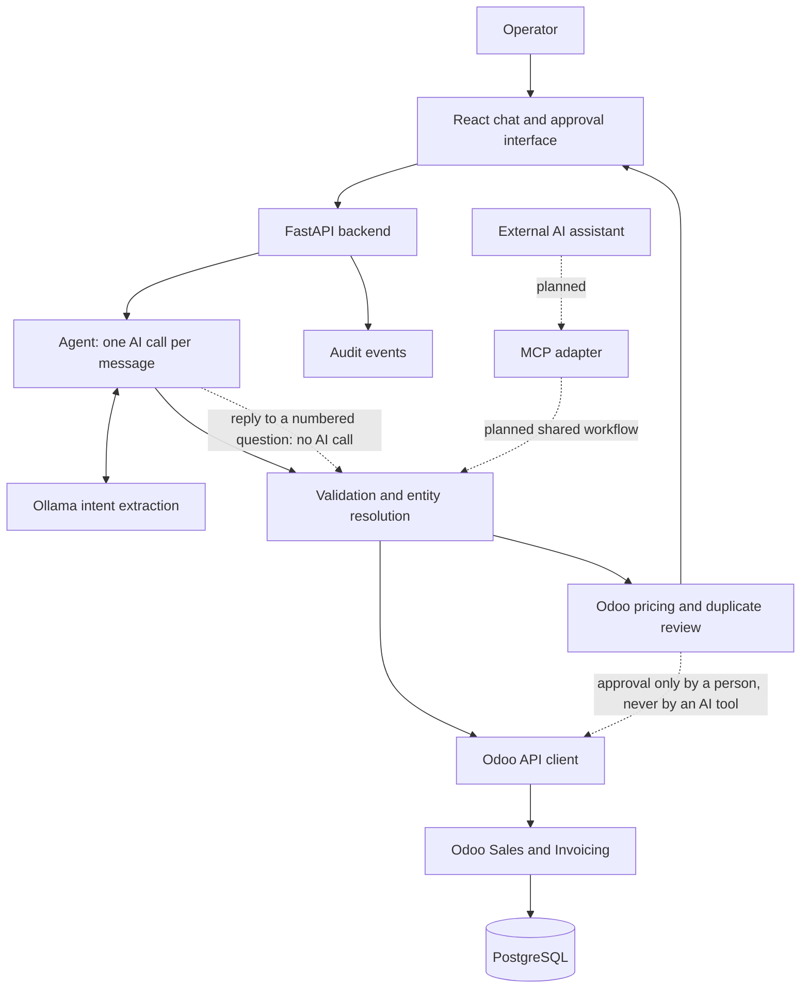
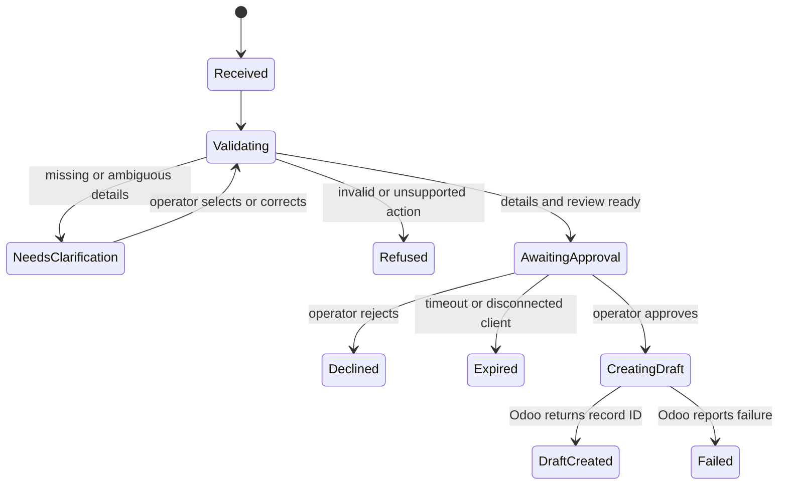

# System Blueprint — AI-Integrated ERP

Version 1.1 · 23 November 2026 · Companion to [PRD](PRD.md) · Readable version: [BLUEPRINT.html](BLUEPRINT.html)

Status — Draft for team and supervisor review. Blueprint is interpreted as the architecture, transaction workflow, data responsibilities and implementation plan. Current-state statements refer to repository commit `33b0168`. Proposed components need implementation and acceptance testing.

## Business workflow

An operator describes a sale. The AI extracts its intent, customer name, product names and quantities. The backend validates the request and resolves those names against Odoo. Missing or ambiguous details return to the operator for clarification. The backend obtains prices, prepares the review and highlights possible duplicates. The operator approves or rejects. Approval creates an Odoo draft and records the outcome. Later posting or sales confirmation follows the organisation's authorised Odoo process.

Example input is “Create a sales order for Pepsi with 3 Chair.” With the seeded Chair price of 50.00, review shows three chairs and a 150.00 subtotal before tax. Rejecting leaves the ERP unchanged. Approving creates a draft quotation with a returned ID.

## Architecture and component status

| Component | Current implementation | Planned completion |
| --- | --- | --- |
| Interface | React/Vite chat, clarification by a typed number or name, and approval controls | Verify readability, corrections, prices and errors across scenarios |
| API | FastAPI chat streaming, confirmation and conversation routes | Bind requests and approvals to authenticated operators |
| Agent | `agent.py` calls the AI once per message, checks the chosen tool and its arguments, and writes every reply itself. A reply to a numbered question continues the request without calling the AI | Verify with the real model that the same sentence always gives the same action (temperature 0, pull request #8) |
| AI | Ollama tools and structured extraction benchmark | Evaluate actual model extraction against the labelled test set |
| Resolver | Exact-first and partial matching, ambiguity choices, controlled product suggestions | Compare matching approaches and evaluate confidence thresholds |
| Odoo client | Restricted reads and creates through XML-RPC, timeouts and thread-local connections | Verify supported Odoo version, permissions, price configuration and failure behaviour |
| Persistence | Odoo records in PostgreSQL, separate JSONL audit events, conversations and pending actions in memory | Durable request-to-record traceability and restart behaviour |
| MCP | Required by charter, implementation not found in reviewed main branch | Expose the shared draft workflow through documented MCP tools |

## What the AI can and cannot reach

The backend's allow-lists in `odoo_client.py` are the safety boundary, whatever the AI sends. The `ai_agent` Odoo user could technically confirm orders and post invoices; the allow-lists are what prevent it.

| | Allowed | Everything else |
| --- | --- | --- |
| Read | Customers (`res.partner`), products (`product.product`), quotations/orders (`sale.order`), customer invoices and credit notes (`account.move`, forced filter). Fixed field lists, at most 50 rows | Refused and logged as `read_blocked` |
| Create | Draft `sale.order`; draft `account.move` with `move_type` fixed to `out_invoice`. Lines carry product, quantity and description only | Refused and logged as `create_blocked` |
| Fields | Unknown fields are dropped and reported. `price_unit` and `discount` are dropped unless `ODOO_ALLOW_AI_PRICES=true` | – |

## Request states and approval boundaries

Current approval permits draft creation. It does not post an invoice or confirm a sales order. Clarification selection (a typed number or name) resolves a name and leads to the review step without a new AI call. Today a closed browser is recorded as `approval_expired` with a reason, the same event as a timeout. It is separate from approval to create.

The proposed shared service must accept each approval once, verify the owning operator and expiry, and preserve an accurate outcome on retries. A network timeout during creation can leave the result uncertain. Reconcile with Odoo before offering a retry that could duplicate the record. The current duplicate warning does not provide idempotency.

## Data model and ownership

| Entity | Main data | System of record |
| --- | --- | --- |
| Partner | ID, name, contact attributes | Odoo `res.partner` |
| Product | ID, name, SKU/reference, price | Odoo `product.product` |
| Quotation/order | Customer, lines, quantities, amounts, state | Odoo `sale.order` and `sale.order.line` |
| Customer invoice | Customer, invoice lines, amounts, state | Odoo `account.move` and `account.move.line` |
| Request | Proposed request ID, original text, action, operator, timestamps and status | Durable workflow/audit storage to be agreed |
| Resolution | Proposed request ID, supplied name, selected Odoo ID, method, score and review decision | Durable workflow/audit storage to be agreed |
| Approval/outcome | Proposed request ID, decision, operator, expiry, Odoo model/ID or error | Durable workflow/audit storage to be agreed |

Use the request ID to join the input, resolution, approval and created-record outcome. A stable reference stored on the draft, or an equivalent durable mapping, must make this link inspectable. Define retention and access before using real personal data.

Current JSONL events and in-memory conversations provide part of this evidence, with one concrete gap. `ai_tool_call`, `approval_requested` and `approval_answered` carry the conversation ID, but the `created` event (Odoo model and ID) does not. A created draft therefore cannot be linked back to its request. First step: write the conversation ID, later the request ID, into the `created` event. The full durable mapping, authenticated operator and recovery semantics follow.

## Interface contract and MCP proposal

The backend should receive business intent containing an action, customer name, product names and positive quantities. Odoo IDs, prices, taxes and record state come from trusted backend/Odoo logic. Validate supported actions and reject unexpected fields. The earlier data-contract document is a proposal and contains choices that differ from later decisions, especially price overrides. The latest recorded default uses Odoo prices with AI prices disabled.

Proposed MCP tools are `lookup_records`, `prepare_sales_order`, `prepare_customer_invoice`, `get_request_status` and `cancel_request`. Preparation returns either clarification information or a pending action ID with review details. Approval is deliberately not an MCP tool: an assistant that can call `approve_draft` can approve its own draft, which removes human control. A person approves in the application's review screen, or through a confirmation that the MCP client shows to the user and that the model cannot answer itself. `get_request_status` returns the draft ID after the decision. Cancelling is safe and may stay a tool. Tool names and transport are proposals for review. Reuse the same validation, resolution, approval and persistence service for MCP and the chat API.

The current chat uses server-sent events such as `confirmation_required`, `tool_call`, `token` and `done`. Preserve the existing interface while introducing the shared service. Document MCP tool schemas and demonstrate the flow from an external assistant.

## Price and matching behaviour

Current review computes subtotals from Odoo product list prices. Saved Odoo amounts can also depend on customer price lists, currency, units, taxes and configuration. Verify review-to-saved-price equality for the supported setup and define its limits. Custom price lists require dedicated tests before broader claims.

Current matching is deterministic exact-first matching with partial fallback, basic plural handling and user selection when ambiguous. Optional unknown-product suggestions are constrained to real Odoo names and require selection. Numeric confidence and threshold evaluation are planned charter work. Compare an exact/partial baseline with an appropriate alternative on the same held-out synthetic cases.

## Verification and delivery sequence

Phases, owners and test gates: [build plan](../planning/BUILD-PLAN.html).

1. Team reviews scope, business rules, contract and MCP ownership with Witek.
2. Freeze a reproducible synthetic dataset and label the 30-to-50-prompt evaluation set.
3. Complete durable traceability and approval ownership/retry checks.
4. Implement the MCP adapter over the shared service and test with an external assistant.
5. Measure entity precision/recall, threshold behaviour, complete sales-order accuracy and entry time.
6. Repeat approval, rejection, ambiguity, pricing and two-session checks on the final commit. Save versioned evidence and rehearse the demonstration.

The 16 November browser test demonstrated these five checks with scripted AI and real Odoo on `f6bb128`. It supports workflow behaviour for that version. Actual model accuracy, final-version regression results and MCP acceptance remain separate measurements.

## Questions for the meeting

- Does this architecture/workflow document match Witek's intended blueprint format?
- Which assistant and MCP transport will be used for the acceptance demonstration, and who owns the adapter?
- Which matching method and confidence threshold will be evaluated?
- Will the demonstration use only seeded list prices or customer-specific price lists?
- How will original input, authenticated approval and the created Odoo record remain linked after restart?
- What evaluation set and measurement procedure will establish the charter's greater-than-90% sales-order result?

## Sources

- Project charter supplied to the team and stakeholder notes supplied on 23 November.
- [Recorded decisions](../decisions/DECISIONS.md)
- [Current resolver](../../../Application/V3.1/backend/resolver.py)
- [Current intent schema](../../../Application/V3.1/backend/intent_schema.py)
- [Data-contract proposal](data-contract/DATA-CONTRACT.md)
- [Recorded tests](../tests/TEST-RESULTS.md)
- [Experiment log: real-model behaviour](../experiments/EXPERIMENT-LOG.md)

## Changes in 1.1

Agent added to the architecture, with the shortcut that skips the AI for numbered replies; allow-lists spelled out; states renamed (Refused, Declined); traceability gap made concrete (`created` event lacks the conversation ID); approval removed from the MCP tools; interface wording corrected; experiment log and build plan linked.
