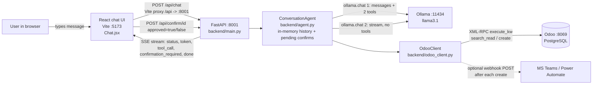
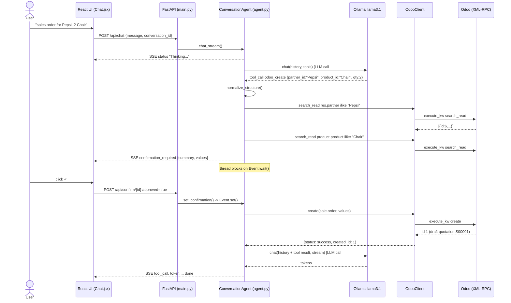

> **Snapshot – 9–10 Nov 2026.** Investigation of the previous group's work, written with Claude Code during the handover (incl. the 23 Sep kickoff notes). Paths like `Application/V3` refer to the previous group's original. For the current state see [CHANGELOG](../changes/CHANGELOG.md), [test results](../tests/TEST-RESULTS.md) and the [experiment log](../experiments/EXPERIMENT-LOG.md).

# AI-Integrated ERP – Codebase Investigation & Technical Handover

*Repository inspected:* `Floydgodlieb/AI-Integrated-ERP` (fork of `LieutenantHazzy/AI-Integrated-ERP`), branch `main`, HEAD `0fba0a4` (2026-06-12). Report date: 2026-11-09.

**Status labels used throughout:** ✅ Implemented & verified · 🟡 Partially implemented · ⚠️ Present but likely broken / unverified · 📄 Documented or planned only · ❓ Cannot verify

---

## TL;DR – the five things you most need to know

1. **What it really is.** A small chat agent: a local LLM (Ollama, `llama3.1`) is given two tools – `odoo_search_read` and `odoo_create` – and talks to Odoo over XML-RPC. It can **read any Odoo model** and **create** sales orders, invoices and customers, with a human approve/decline dialog before every create. That is the whole product (about 1,100 lines of Python across V1–V3; V3 itself is ~600 lines of Python plus a small chat UI). **V3 is the current version** (`Application/V3/`); V1 and V2 are earlier prototypes.
2. **I actually ran it.** I stood up a real **Odoo 19.0 Community** (Docker), installed the V3 backend, and drove it end-to-end. The plumbing works: login, read, create-with-approval, rejection, hallucinated-customer rejection, draft sales order and draft invoice created in Odoo. **Caveat:** the LLM was a scripted stand-in (Ollama's download host is blocked in my sandbox), so this verifies the *code*, not llama3.1's *behaviour or latency*.
3. **I found real defects that will hurt a live demo** (all reproduced): (a) with ≥2 simultaneous users the shared Odoo connection breaks – **28 of 40 parallel requests failed**; (b) **40 abandoned approval dialogs freeze the server for all new chats** (thread exhaustion, no timeout); (c) fuzzy name matching silently picks the wrong customer/product (`"a"` → product *Chair*); (d) LLM-supplied prices are accepted (invoice created at 10 while list price is 50); (e) the agent can read **any** Odoo model; (f) orders stay *draft*, invoices stay *draft* and are *not linked* to the order – the "order-to-invoice" flow is not actually implemented.
4. **Latency is almost certainly the LLM, not Odoo.** Odoo calls took 8–200 ms on a small DB. Every chat turn makes **2 sequential LLM calls**, there is no model keep-alive, the history grows unbounded, and the hardware target was laptops/CPU. (Estimate – I could not measure llama3.1; see Part 6.)
5. **Security housekeeping first.** A real Odoo username/password is hard-coded in `V1/main.py:12`, `V1/login.py:6`, `V2/main.py:12`, and a signed **Microsoft Teams/Power Automate webhook URL** is hard-coded in `V2/main.py:15` – all in Git history. Rotate/revoke them and never reuse them. `__pycache__/*.pyc` is committed (shows the previous group used **Python 3.14**).

**My recommendation in one line:** keep the V3 skeleton (FastAPI + SSE + React confirm dialog), but **rewrite the agent core** into a deterministic, validated *order-to-cash invoicing pipeline* where the LLM only extracts structured data, and build a small **evaluation + latency benchmark harness** first (Part 9).

---

## Kickoff meeting (Wed 23 Sep 2026) – what it confirms, changes and adds

*Source: your meeting notes (supervisor "Witek"). I have not seen the transcript itself, only the summary.*

| Meeting point | What the code/repo shows | Consequence for you |
|---|---|---|
| "Previous group processed **one order type**" | ✅ Matches: V3 creates sales orders/invoices only, as drafts, via one LLM round (`agent.py:235-333`) | "One order type" is really *create-draft-only*; no confirm/post/pay/update |
| "**Latency notably slow**" | The supervisor's observation is **consistent with** the code (2 sequential LLM calls, no keep-alive, unbounded history; Odoo itself answers in ms). I could not measure the LLM | Direction B (latency workstream) is explicitly endorsed. **Ask the previous group which step felt slow and on what hardware** |
| "Odoo already has an **Ask AI** feature worth exploring" | Previous group's setup (Community in Docker) has **no** built-in AI. Odoo docs say Ask AI **cannot change the database**, uses OpenAI/Gemini (or IAP credits in 20.x), and no local model option (Part 8.1). Edition availability is not stated in the docs; third parties say Enterprise (unverified) | Do a **1–2 hour hands-on check on a trial/Enterprise instance** (e.g. an Odoo Online trial – verify availability) before you claim anything in your presentation. Your differentiator: *writes* + *local* + *validated* |
| "Previous group's **videos/materials** in the group chat" | Not in the repo (I could not see them) | Watch them **before** the first team meeting; they should answer: Odoo version/modules, hardware, demo script, latency feel. Compare against Part 7 |
| "**Request their repo** via HAN email" | You already hold a fork of `LieutenantHazzy/AI-Integrated-ERP` (43 commits). A fork only contains what was pushed: **no `.env`, no Odoo DB dump/seed data, no unpushed branches, no `LICENSE`** | Ask for: Odoo DB backup or seed script, `.env` *structure* (not passwords), unpushed work, and **written permission/licence to reuse** (the repo has no LICENSE file). Note the V1/V2 code contains a `@student.han.nl` Odoo login name that likely belongs to a previous-group member – use it only as a lead and confirm via your supervisor/the group chat |
| "**Start small**, one ERP area; invoicing as an example" | Direction A (invoicing slice) | Confirmed as the safest first scope |
| "Students own their repos; **commercial potential**" | Business-plan docx is generic; PRD/ontologies are reusable. No licence file | Decide early whether you want your own licence and clean repo (secrets removed) – relevant if you pursue commercial use |
| "Starts in **week 7** (week 6 = bootcamp)", weekly 30-min sprint with Witek | – | Use the report's top-5 list as your sprint-1 backlog; bring *test results/latency numbers* to each sprint – grading is on **growth, learning, experimentation** |
| "**Stop active development 2 weeks** before the end presentation; **live demo** (or video)" | Live demo risk: LLM latency/non-determinism (Part 10.1) | Plan a **feature freeze at T-2 weeks**, record a backup video of the working flow early, rehearse with a fixed dataset |
| Pre-week-7 tasks: review documents; **1–2 internal meetings**; research landscape; define roles | Parts 4, 8, 10.4 | See the checklist below |

### Pre-week-7 checklist (derived from the meeting)
1. ☐ Everyone reads Parts TL;DR, 1, 3, 4 (≈45 min); watch the previous group's videos.
2. ☐ **Team meeting 1:** run the setup in Part 7 together; confirm everyone's laptop can run `ollama pull llama3.1` and respond in a reasonable time (record seconds per reply – this is your baseline).
3. ☐ Email the previous group (questions in 10.2) – **send this first, it has the longest lead time**.
4. ☐ Rotate/revoke committed secrets (TL;DR item 5); create your own `.env`, never commit it.
5. ☐ **Ask AI check** (hands-on, 1–2 h) and write down what it can/can't do – this is a named "next step" from the supervisor.
6. ☐ Landscape research: Part 8 is a head start, but **verify the unverified items** you plan to quote (vendor claims were snippet-level).
7. ☐ **Team meeting 2:** choose direction (Part 9), assign roles (10.4), agree the demo scenario and the definition of done for sprint 1.
8. ☐ Create a shared "experiment log" (hypothesis → test → result) – it doubles as grading evidence.

---

## Clarifying questions & my assumptions

You asked for questions before the report. None blocked the analysis, so I proceeded with these assumptions – tell me if any is wrong:

| # | Assumption | Why it matters |
|---|---|---|
| A1 | The previous group used the **official Odoo Docker image, Community edition**, most likely **19.0** (`previous-group/technical/installing-odoo.md` says Docker; "latest" in spring 2026 was 19.0 – *inference*). | Determines which Odoo AI features and APIs apply. **Ask the previous group.** |
| A2 | `llama3.1` (8B default tag) via **Ollama** is the model (`agent.py:242`). The exact tag/quantisation is not stated anywhere. | Latency/accuracy. |
| A3 | Your team will have laptops without a big GPU (the previous group's notes say CPU-only LocalAI/Ollama). | Drives latency advice. |

---

# PART 1 – Executive overview

**What is it?** "Invisible ERP": instead of clicking through Odoo's screens, a user types *"create a sales order for Pepsi with 2 chairs"* in a chat window. A local AI model turns that into a structured Odoo action; the user clicks ✓ to approve; the record is created in Odoo (`README.md`, `documentation/previous-group/product/prd.md`).

**Problem it targets.** SMEs lose time on manual data entry and fragmented tools (`PRD.md §2`).

**What AI contributes.** (1) Understanding free text; (2) choosing which Odoo operation to call (function calling); (3) summarising results back in natural language. The AI does *not* currently do prediction, anomaly detection, forecasting or confidence scoring, although the PRD promises these.

**ERP processes currently targeted.** Sales (`sale.order`), customer invoicing (`account.move` with `move_type=out_invoice`), customers (`res.partner`). Procure-to-Pay exists only as a documentation ontology.

**Who would use it.** Sales staff, operations managers, finance/admin at SMEs (`PRD.md §5`).

**Intended end result.** A conversational layer on top of an existing ERP, "assist, not automate blindly", with human approval, audit trail and rollback (`PRD.md §3.3, §4`).

**Difference from a conventional ERP.** Natural-language input instead of forms; sits on top of Odoo rather than replacing it.

**Current state.** Working prototype (V3) with a chat UI. Handles creating one kind of order/invoice via a single LLM round. Several reliability and safety gaps (Part 6).

### Summary (purpose and verified capabilities)
- **Purpose:** natural-language front end for Odoo using a local LLM, human-approved writes.
- ✅ Authenticates to Odoo via XML-RPC; reads any model; creates records only after UI approval (tested on Odoo 19.0 Community).
- ✅ Resolves customer/product *names* to Odoo IDs and rejects names that do not exist.
- ✅ Streams responses to a React UI over Server-Sent Events; confirm/decline dialog works.
- 🟡 Creates draft sales orders and draft invoices only; no confirm/post/link/pay; no update/delete tools.
- ⚠️ Breaks under concurrent users; hangs after abandoned approvals; fuzzy matching can pick the wrong record.
- ❓ llama3.1 accuracy and latency not measured (no model access in my sandbox).
- 📄 PRD features (confidence scores, anomaly detection, forecasting, audit trail, rollback, permissions) are not in the code.

---

# PART 2 – Technical architecture

## 2.1 Stack (all verified from files)

| Layer | Technology | Evidence |
|---|---|---|
| Language (backend) | Python (pycache shows **3.14**; I ran it on 3.13 – works) | `V3/backend/__pycache__/*.cpython-314.pyc` |
| Backend framework | FastAPI + Uvicorn, `sse-starlette` for streaming | `V3/backend/requirements.txt`, `V3/backend/main.py` |
| LLM runner | **Ollama** (Python client `ollama>=0.4.0`), model **`llama3.1`** hard-coded | `agent.py:242, 318`; `documentation/previous-group/technical/what-model-to-use.md` |
| ERP | **Odoo** (self-hosted, Docker; edition/version not recorded in the repo), DB **PostgreSQL** | `previous-group/technical/installing-odoo.md`; `.env.example` (`ODOO_URL=http://localhost:8069`) |
| ERP API | **XML-RPC** (`/xmlrpc/2/common`, `/xmlrpc/2/object`, `execute_kw`) | `odoo_client.py:17-22` |
| Frontend | React 19 + Vite 8 (+ React Compiler), plain `fetch` + manual SSE parsing | `chat-UI/package.json`, `Chat.jsx` |
| Notifications | Microsoft Teams (Power Automate webhook, Adaptive Card) – optional | `odoo_client.py:24-56` |
| Deployment | **None.** No Dockerfile/compose for the app, no CI, no tests. Launcher `V3/main.py` is **Windows-only** (`.venv\Scripts\python.exe`, `npx.cmd`) | `V3/main.py:8,22` |
| Auth | Single shared Odoo service account from `.env`; **no user auth on the API** | `main.py:19-22` |

## 2.2 Architecture diagram (actual V3 component flow)



## 2.3 How components communicate

| From → To | Protocol / format | Endpoint |
|---|---|---|
| Browser → Vite | HTTP; Vite dev-server proxies `/api` → `localhost:8001` (`vite.config.js`) | – |
| UI → Backend | JSON `POST` | `/api/chat`, `/api/confirm/{id}`, `DELETE /api/conversation/{id}` |
| Backend → UI | **SSE** events `status`, `token`, `tool_call`, `confirmation_required`, `done` | `/api/chat` response |
| Backend → Ollama | HTTP/JSON (`/api/chat`), tool schemas as JSON Schema | default `127.0.0.1:11434` |
| Backend → Odoo | XML-RPC over HTTP | `/xmlrpc/2/common`, `/xmlrpc/2/object` |
| Backend → Teams | HTTPS JSON (Adaptive Card) | `TEAMS_WEBHOOK_URL` |

## 2.4 V1 vs V2 vs V3

| | **V1** (`Application/V1/`) | **V2** (`Application/V2/main.py`, 340 lines) | **V3** (`Application/V3/`) |
|---|---|---|---|
| Interface | one-shot script | CLI chat loop | React chat UI + REST/SSE API |
| Tools | `odoo_search_read` only | + `odoo_create` | same two tools |
| Odoo access | module-level globals | module-level globals | `OdooClient` class |
| Entity names → IDs | none (LLM must know IDs) | none; few-shot examples with fixed IDs (`partner_id: 72`) | **`resolve_entities()`** looks names up (`agent.py:181`) |
| Human approval | none | none (a `run`/`fetch` keyword runs the last JSON the model printed) | **UI confirm dialog** before every create |
| Config | hard-coded creds | hard-coded creds + Teams URL | `.env` (+ `.env.example`) |
| Teams alerts | – | yes | yes (silent on failure) |
| Docs | `documentation/previous-group/technical/v1-documentation.md` | – | – |

Evolution: V1 proved function-calling works (Mar–May) → V2 added create + invoice + conversation + hacks to repair malformed model output (regex JSON repair, auto-corrections, `V2/main.py:267-324`) → V3 replaced hacks with **name→ID resolution, explicit approval, a proper API and UI**. Git: V2 merged via PR #1 (30 May), V3 via PR #3 (12 Jun). **V3 is current.**

## 2.5 Component notes (what / where / why / weaknesses)

| Component | Where | Does | Weakness / improvement |
|---|---|---|---|
| **API layer** | `V3/backend/main.py` | Routes, SSE, global `agent` singleton, CORS `*` | No auth; wide-open CORS; singleton shared by all users |
| **Agent** | `V3/backend/agent.py` (335 lines) | Prompt, tools, name resolution, approval, 2 LLM calls | One file mixes prompting, validation, UI summaries, state; single tool round only; unbounded history |
| **Odoo client** | `V3/backend/odoo_client.py` | XML-RPC wrapper, "auto-corrections", Teams | **Not thread-safe** (shared `ServerProxy`), no retries/timeouts, errors swallowed |
| **Chat UI** | `V3/chat-UI/src/Chat.jsx` | SSE parsing, tables, confirm modal | Hand-rolled SSE parser loses newlines; placeholder text ("YourERP") left in header |
| **Launcher** | `V3/main.py` | Starts both servers | Windows-only |

---

# PART 3 – How the program actually works

## 3.1 One complete transaction (V3), step by step

Example: user types *"create a sales order for Pepsi, 2 Chair"*.

| # | Step | File : lines / function | What happens |
|---|---|---|---|
| 1 | User starts request | `Chat.jsx` `handleSend` | Generates a 12-char `conversation_id` in the browser; `fetch('/api/chat', {message, conversation_id})` |
| 2 | Backend receives | `main.py:76` `chat()` | Pydantic `ChatRequest`; ensures Odoo login exists (`ensure_agent`, `main.py:27`); wraps `agent.chat_stream()` in `EventSourceResponse` |
| 3 | Input processed | `agent.py:235` `chat_stream` | Appends user text to in-memory history (`get_or_create_history`, `agent.py:119`); emits SSE `status: Thinking...` |
| 4 | Prompt construction | `agent.py:6-35` + `agent.py:37-88` | History = `[system prompt] + all prior turns`; **2 tool schemas** attached. No retrieval, no examples, no Odoo schema info |
| 5 | **LLM call #1** | `agent.py:241-245` `ollama_chat(model='llama3.1', messages=history, tools=TOOLS)` | Non-streaming; blocks until the model decides (text reply *or* tool call) |
| 6 | AI interprets | `response.message.tool_calls` | For a create the model returns `odoo_create{model:"sale.order", values:{partner_id:"Pepsi", product_id:"Chair", product_uom_qty:2}}` – **names, not IDs** (the prompt tells it to, `agent.py:20-24`) |
| 7a | Normalise | `agent.py:155` `normalize_structure` | Wraps flat `product_id/qty/price` into `order_line: [[0,0,{...}]]`; fixes `quantity`↔`product_uom_qty` |
| 7b | Resolve names → IDs (**the "validation"**) | `agent.py:181` `resolve_entities` | For `partner_id`, `product_id`, `user_id` strings: `search_read(model, [["name","ilike",value]])`, take **first hit**; no hit → `ValueError` → error returned to the model. Stores `_resolved_*_name` for display |
| 8 | Human approval | `agent.py:268-285`; `main.py:104`; `Chat.jsx` `handleConfirm` | Emits SSE `confirmation_required{summary, model, values}`; **thread blocks on `threading.Event.wait()`** until `POST /api/confirm/{id}` |
| 9 | Execute in Odoo | `agent.py:144` `execute_create` → `odoo_client.py:68` `create` → `execute_kw(..., "create", [values])` | Strips `_resolved_*` keys, applies `_apply_auto_corrections` (line 83), creates. Odoo creates a **draft** `sale.order` (quotation) |
| 10 | Teams alert | `odoo_client.py:24-56` | If webhook set, synchronous POST (**no timeout**); failures silently ignored |
| 11 | Result → LLM | `agent.py:296-301`, `317-321` | Tool result appended as `role: tool`; **LLM call #2** (streaming, **no tools**) summarises |
| 12 | Return to user | SSE `tool_call`, `token`…, `done` | UI shows a table for list results, streams tokens into the chat bubble |

Read queries follow steps 1-5, then `execute_search_read` (`agent.py:132`) → `search_read` **without approval** → LLM call #2.



## 3.2 AI integration in detail

| Question | Answer (evidence) |
|---|---|
| Model & access | `llama3.1` via the Ollama Python client to `localhost:11434`; hard-coded in two places (`agent.py:242, 318`); not configurable |
| System prompt | `agent.py:6-35`. Summary: you are an Odoo ERP assistant; ask for missing details; summarise tool results, no raw JSON; `domain` must be a real array; never use `*`; **pass customer/product *names*, the system resolves IDs**; model→Odoo-model map; don't mix `sale.order` and `account.move` fields; invoice = `account.move` + `move_type: out_invoice` |
| Context supplied | System prompt + whole conversation (incl. full JSON of every tool result). **No** product catalogue, price list, customer list, or Odoo field metadata |
| Tools / function calling | Yes, 2 tools (`agent.py:37-88`): `odoo_search_read(model, domain, fields)` and `odoo_create(model, values)`. **`model` is a free string** – no allow-list. No update/delete/confirm/post tools |
| Structured output | Tool-call JSON schema only. `domain` and `values` are untyped (`array`/`object`). Ollama's `format`/JSON-schema structured output is **not used** |
| Error handling | `try/except` around read/create; error dict is fed back to the model; Odoo exceptions become `{"error": str(e)}`; Teams failures swallowed (`odoo_client.py:55`); `ValueError` on unresolved names |
| Output validation | Only: name→ID existence check, key renaming, strip `_resolved_*`. **No** check of prices, quantities, dates, field names, duplicates or business rules |
| Harmful-operation prevention | Create requires UI approval (✅ verified). Reads need none. No delete/update tool exists. But `search_read` can read *any* model/field the Odoo account can (✅ verified: read `ir.config_parameter`, `res.users`) |
| Autonomous or human-approved | **Human-approved for creates**, autonomous for reads |
| Multi-step reasoning | **None.** One tool round per turn; LLM call #2 has no tools so it cannot chain (e.g., *look up price → then create*) |
| Not established | Real llama3.1 accuracy, how often it emits malformed/"text JSON" tool calls, latency |

---

# PART 4 – Repository breakdown

```
README.md                         project charter (short, partly outdated vs. code)
Application/
  V1/main.py, login.py            read-only tool-calling prototype (obsolete)
  V2/main.py                      CLI agent with create/invoice (obsolete; superseded)
  V3/                             CURRENT
    main.py                       Windows-only launcher
    .env.example, .gitignore
    backend/{main,agent,odoo_client}.py, requirements.txt, __pycache__/ (should not be committed)
    chat-UI/                      React + Vite app (src/Chat.jsx is the only real file)
documentation/                    PRD, TDD, ontologies, model choice, Odoo install, ethics, planning, debate, 2 .docx
.vscode/settings.json             trivial
```

| Path | Purpose | Central? | Depended on by | Will we change it? |
|---|---|---|---|---|
| `V3/backend/agent.py` | Brain: prompt, tools, resolution, approval flow | **Yes – most important** | `main.py` | **Heavily** – split into modules, add validation, loop, structured output |
| `V3/backend/odoo_client.py` | ERP gateway | **Yes** | `agent.py`, `main.py` | **Yes** – thread safety, retries, JSON-2 option, whitelisting |
| `V3/backend/main.py` | HTTP API | Yes | UI | Moderate – auth, timeouts, config |
| `V3/chat-UI/src/Chat.jsx` | UI + SSE client | Yes | – | Moderate – SSE fix, richer approval card |
| `V3/.env.example` | Config contract | Yes | `main.py` | Add `OLLAMA_*`, model name |
| `documentation/previous-group/business-processes/ontology-order-to-invoice.md` | Business rules/roles/forbidden actions for O2C | **Gold for us** – not wired to code | nothing | Turn into executable rules |
| `documentation/previous-group/product/prd.md`, `previous-group/product/tdd.md` | Intent/requirements (TDD partly outdated: says CLI, SQL) | Context | – | Update |
| `documentation/*.docx`, `previous-group/research/debate-20-rounds.md` | Business plan; "market research"; LLM-simulated debate | Background only | – | No |
| `V1/*`, `V2/main.py` | History | No | – | Delete or archive |

**Recommended reading order:** (1) `README.md` → (2) `documentation/previous-group/product/prd.md` → (3) `documentation/previous-group/business-processes/ontology-order-to-invoice.md` → (4) `V1/main.py` (tiny, shows the core idea) → (5) `V3/backend/odoo_client.py` → (6) `V3/backend/agent.py` (start at `chat_stream`, line 235) → (7) `V3/backend/main.py` → (8) `V3/chat-UI/src/Chat.jsx` → (9) `V2/main.py` (to understand *why* V3 is built the way it is) → (10) `previous-group/technical/what-model-to-use.md`, `previous-group/technical/installing-odoo.md`, `previous-group/team/ethics.md`.

**Obsolete / duplicate / safe to ignore:** `V1/` (both files), `V2/main.py`, `V3/backend/__pycache__/`, `V3/chat-UI/src/assets/*` (Vite template art), `chat-UI/README.md` (Vite boilerplate), `App.css` (empty), `previous-group/team/github-guide.md` (generic), `TDD.md §2-3` (CLI/SQL – outdated), `previous-group/product/planning.md` (stub).

---

# PART 5 – What the previous group accomplished

## 5.1 Timeline (Git: 43 commits, 24 Feb → 12 Jun 2026)

Authors (git shortlog): `lieutenant_hazzy`/`xunil`/`LieutenantHazzy` (the same person under three identities: 31 commits, all code), `Anastasios9` (7, doc uploads), `LyndonBoesveld` (5, PRD/ontology). *Note: PR #2 does not appear in history.*

| Phase | Dates | What happened | Evidence |
|---|---|---|---|
| 0. Setup | 24 Feb–16 Mar | Repo init, GitHub guide | `f6ad68b`…`4d99864` |
| 1. Design docs | 24 Mar–7 Apr | TDD, PRD, README, middleware idea; doc uploads | `c20678a`, `d4094ee`, `aa0dad0` |
| 2. Environment | 28 Mar–13 Apr | Odoo install (struggles with Postgres → Docker), model-runner decision (Ollama), `llama3.1` | `previous-group/technical/installing-odoo.md`, `previous-group/technical/what-model-to-use.md`, `efd8cfd` |
| 3. Planning refinement | 14 Apr–12 May | PRD revised after LLM-simulated debate; ontologies (O2I, P2P) | `822be6f`, `e51c33d`, `9060e5c` |
| 4. **V1** | ~6 May | Read-only tool-calling script | `103da9b` |
| 5. **V2** | 18 May–9 Jun | `odoo_create`, conversation loop, customer creation, invoices, Teams alerts; PR #1 merged 30 May | `bcf5c7a`, `9cea77a`, `b9ab8b4`, `d1ddd8d`, `fa0e2aa` |
| 6. **V3** | 10–12 Jun | Rewrite: FastAPI backend, entity resolution, approval dialog, React chat UI; PR #3 merged 12 Jun | `d300955` (30 files, 4,301 insertions in one commit) |

## 5.2 Claimed/planned vs. verified

**Claimed or planned (docs):** a JSON statement sent to the right endpoint (README); CLI + REST + middleware (TDD); invoice recognition/matching, inventory anomaly detection, cash-flow forecasting, confidence scores, audit trails, rollback, permission controls, spreadsheet import/export, data-cleanup (PRD); SaaS+credits pricing (Business Plan); Procure-to-Pay and Order-to-Invoice ontologies with roles, forbidden actions and exceptions.
**Verified in code:** only the items marked ✅/🟡 below.

## 5.3 Feature table

| Feature / Component | Implementation (where & how) | Status | Evidence | Remaining work |
|---|---|---|---|---|
| Odoo login & read queries | `odoo_client.py:17,58`; tool `odoo_search_read` | ✅ | Ran against Odoo 19.0: customers list returned | Allow-list models/fields; pagination/limits |
| Create sales order | `odoo_create` → `sale.order` + `order_line` | 🟡 ✅ | S00001 created, draft, total 115.0 incl. tax | Confirm (`action_confirm`), stock/delivery, price from pricelist |
| Create customer invoice | `account.move` `out_invoice` | 🟡 | Draft invoice created, 34.5 | Post, link to SO, price validation, payment |
| Create customer (res.partner) | same tool | ⚠️ | Not tested end-to-end; relies on LLM | Duplicate check |
| Name→ID resolution | `agent.py:181` | 🟡 ✅ | Hallucinated customer rejected; but ambiguous matches silently resolved | Exact/fuzzy ranking, ask user on ambiguity |
| Human approval before create | `agent.py:268-285`, `Chat.jsx` | ✅ (with defects) | Approve → created; decline → nothing created | Timeouts; show full line details; server-side auth |
| Streaming chat UI | SSE + React | 🟡 | Build OK; newline bug in parser | Fix parser; lint errors |
| Multi-turn conversation memory | in-memory dict | 🟡 | Works per process | Persistence, trimming |
| Teams notifications | `odoo_client.py:24` | ❓ | Webhook not testable (secret blocked/unavailable) | Timeout, async, retry |
| Update / delete / confirm / post | — | 📄 | No tool exists | Add as *named, constrained* actions |
| Order-to-Invoice ontology rules | `documentation/` | 📄 | Not referenced in code | Implement as validators |
| Procure-to-Pay | `documentation/` only | 📄 | — | Out of scope unless chosen |
| Confidence scores, anomaly detection, forecasting, rollback, audit trail, permissions | PRD only | 📄 | grep finds nothing in code | Pick one |
| Tests | — | 📄 (none) | no test files, no CI | Build eval + unit tests |
| Docker/deployment for the app | — | 📄 (none) | — | Compose file |
| Latency measurement/optimisation | — | 📄 (none) | no timing code | See Part 6 |

## 5.4 Questionable decisions we must understand before changing code

1. **LLM chooses the Odoo model and fields freely** (`model: string`). Convenient, but it is also the root of most safety/reliability issues.
2. **"Auto-correction" layer** (`odoo_client.py:83`, duplicated in `agent.py:155`): renames fields after the LLM gets them wrong. This patches symptoms of weak prompting/lack of structured output; the logic is duplicated in two places.
3. **Names, not IDs, are passed to resolution with `ilike` + first hit** – wrong-record risk (verified).
4. **Single global agent/Odoo connection** – not multi-user safe (verified).
5. **Approval implemented by blocking a worker thread** – leaks threads (verified).
6. **Assistant tool-call message is never added to history** (`agent.py:247-301`; I confirmed the second LLM call receives `[system, user, tool]` with no assistant turn). Non-standard for tool-calling models; may confuse llama3.1.
7. **Odoo account is likely admin-level** (`previous-group/technical/installing-odoo.md` registers the first user) – the LLM acts with admin rights.
8. **XML-RPC** is Odoo's legacy external API; Odoo 19 adds `/json/2` (see Part 8).

---

# PART 6 – What works well and what needs improvement

## 6.1 What works well

| Strength | Why it's good | Evidence |
|---|---|---|
| **Human-approval gate for writes** | Matches the PRD's "assist, not automate blindly"; stops hallucinated writes | Verified decline → no record |
| **Entity resolution + rejection of unknown names** | Directly mitigates the commonest LLM hallucination (invented customers) | Verified: `"Nonexistent Corp XYZ"` rejected |
| **Clean separation V3: UI / API / agent / Odoo client** | Easy to swap pieces; frontend builds in <1 s | Build ✅ |
| **Streaming UX with status events** | Perceived latency reduced; user sees "Thinking… / Executing… / Interpreting…" | `agent.py:239,288,315` |
| **Local, free model; Odoo in Docker** | Fits "self-hosted, no limits" requirement; privacy-friendly | `previous-group/technical/what-model-to-use.md` |
| **Good documentation of intent** | PRD/ontologies are a ready-made spec of business rules | `documentation/` |
| **Secrets moved to `.env` in V3** | Right direction (`.env` is git-ignored, `.env.example` provided) | `V3/.gitignore` |

## 6.2 What needs improvement

### Verified test results (my environment: Odoo 19.0 Community in Docker, V3 backend unchanged, **scripted fake LLM**)

| Test | Result |
|---|---|
| Backend start + Odoo auth | ✅ health OK; auth 0.6 s |
| Read customers via tool call | ✅ |
| Create sales order (approve) | ✅ S00001 draft, line price **taken from product list price** (50) |
| Create invoice (approve) | ✅ draft; **LLM-supplied price (10) accepted although list price is 50** |
| Decline | ✅ nothing created |
| Hallucinated customer | ✅ rejected with error |
| Fuzzy matching | ⚠️ `"pep"`→Pepsi, `"L"`→L. Luther, product `"a"`→Chair, `"Floor"`→Chair Floor Protection – **no ambiguity check** |
| Read arbitrary model | ⚠️ read `ir.config_parameter` and `res.users` succeeded |
| 40 parallel chats | ❌ **28 of 40 failed** (`Request-sent`, `Idle`, `Bad file descriptor`) – shared non-thread-safe XML-RPC connection |
| 45 abandoned approvals (client disconnects) | ❌ first 40 accepted; **every later chat hung** (HTTP 200 but no data for >10 s); async endpoints still answer, so `/api/health` stays "ok" |
| Odoo latency (tiny DB, same host) | search_read 8 ms; create SO 55 ms; create invoice ~190 ms |
| Frontend `npm ci && vite build` | ✅ builds; **ESLint: 2 errors** (`Chat.jsx:113,118` empty `catch`); `npm audit`: 14 vulns (6 moderate, 8 high) in the dev toolchain |
| Wire format of SSE | Multi-line token text is emitted as several `data:` lines; `Chat.jsx` reads only the first (`next = lines[i+1]`) → **newlines/lists are lost** in the (`pre-wrap`) bubble |

**What I could not test:** real llama3.1 behaviour/latency; Teams webhook; V1/V2 scripts end-to-end; Odoo Enterprise; multi-company/tax edge cases.

### AI performance & latency (ranked by likely impact; estimates are *inferences* – measure them)

| # | Likely cause | Evidence | Impact |
|---|---|---|---|
| 1 | **LLM inference on laptop/CPU** with an 8B model; prompt processing of system prompt + tools + growing history on every call | `previous-group/technical/installing-odoo.md` stresses CPU-only/laptop use (hardware actually used for the demo is unknown ❓); `agent.py` | **Highest** – likely seconds to tens of seconds per call |
| 2 | **Two sequential LLM calls per turn** (decide, then summarise) | `agent.py:241, 317` | High – ~2× latency; the summarise call is often unnecessary for a create (the UI already shows the result) |
| 3 | **Cold start / model unload** – no `keep_alive`; Ollama default is 5 min (per Ollama docs, see Part 8-D) | not set anywhere | High for the first request after idle |
| 4 | **Unbounded history incl. raw `search_read` JSON** fed back each turn; small default context (4096 tokens per Ollama FAQ, version-dependent) | `agent.py:296-313` | Medium→high, grows with use; also truncation risk |
| 5 | **Sequential name lookups** (1 Odoo call per entity, serial) | `agent.py:196` | Low (ms each) – Odoo is *not* the bottleneck in my tests |
| 6 | Synchronous Teams POST inside `create`, **no timeout** | `odoo_client.py` | Low normally; can hang a create if the webhook is slow |
| 7 | Slow-down opportunities: skip LLM for deterministic steps (resolution, validation, formatting results), cache customer/product lists, smaller/faster model, structured-output instead of free tool loop, streaming first token earlier | – | Quick wins |

### Architecture
- Modularity: acceptable skeleton but `agent.py` is a monolith; "adding invoicing" meant copy-pasting per-model special cases (`normalize_structure`, `_apply_auto_corrections`, `_summarize_create`). **Adding a new ERP process is currently a code change in 4 places.** Better: a registry of *actions* (name, JSON schema, resolver, validator, executor, summariser).
- No tests, no CI, no Docker for the app, Windows-only launcher, global singletons, in-memory state.

### AI reliability
- Output is *not* constrained: `values` is a free object; no use of Ollama structured output.
- Hallucinated customers/products are caught; **hallucinated prices, quantities, dates, field names are not**.
- No evaluation set: nobody knows the accuracy of llama3.1 on these tasks.
- Human oversight: good for creates; none for reads.

### ERP integration
- Auth: a single user/password in `.env` (no API key, no per-user identity). No retries, no timeouts, silent failures.
- Hard-coded assumptions: model names (`sale.order`, `account.move`, `res.partner`), `move_type`, field names that differ across Odoo versions; `product.product` vs `product.template`.
- Duplicates: **no idempotency** – re-sending the same message creates a second order (invoice, etc.). Invoices are **not linked** to sales orders, so the same sale can be invoiced twice.
- Drafts only: sales orders stay quotations; invoices stay drafts (this is actually a *safe default* – keep it, but make it deliberate).
- Version coupling: XML-RPC works for Odoo 17–19; per Odoo's docs the `common`/`object` services are scheduled for removal in a future version (see Part 8) – plan an adapter.

### Code quality, security, maintainability
- **Secrets in Git history** (credentials in V1/V2; Teams webhook in V2). **Rotate.** Consider scrubbing history or at least not reusing them.
- No auth on API; `CORS *` with credentials; conversation IDs client-chosen; **anyone who knows a `conv_id` can approve a pending create**.
- **Prompt injection:** tool results (Odoo data such as product names/notes, partner comments) are fed back to the LLM unsanitised; a record containing "ignore previous instructions…" could steer later calls. With the approval gate this is bounded for writes but not for reads of sensitive models. *(Inference – not tested with a real LLM.)*
- Unpinned Python dependencies (`>=`), no lock file; npm has a lock file.
- Dead code: placeholder `if "partner_id" in values … pass` (`agent.py:167-168`); empty `except` blocks.

### Impact vs. effort ranking

| # | Improvement | Impact | Effort | Top 5? |
|---|---|---|---|---|
| 1 | Fix concurrency: per-request/pooled Odoo connection (or lock) | High | Low | ✅ |
| 2 | Approval without blocking threads: store pending action, make it a separate request, **timeouts/expiry** | High | Medium | ✅ |
| 3 | **Strict action schemas + validation layer** (allow-listed models/fields, price/qty/date checks vs. Odoo, ambiguity → ask user, idempotency/duplicate check) | **Very high** | Medium | ✅ |
| 4 | **Measure & cut latency**: timing instrumentation, `keep_alive`, one LLM call per turn, trim history, smaller/faster model benchmark | High | Medium | ✅ |
| 5 | **Eval harness** (30–50 scripted prompts with expected Odoo outcomes) – enables everything else and is great "growth/learning" evidence | High | Medium | ✅ |
| 6 | Rotate/remove committed secrets; commit hygiene (`__pycache__`) | High (security) | Low | do immediately |
| 7 | Auth + restrict CORS; per-user Odoo identity or API key | Medium | Medium | |
| 8 | Link SO→invoice (`_create_invoices`), confirm/post as explicit approved actions | Medium | Medium | |
| 9 | Fix SSE parsing; ESLint errors; update deps | Low-Med | Low | |
| 10 | Dockerise (compose: Odoo, Postgres, Ollama, backend, UI); cross-platform launcher | Medium | Low | |

---

# PART 7 – Getting it running

I ran the steps marked **[verified]** on Linux (Docker, Python 3.13, Node 22). The previous group's launcher targets Windows, so I give manual commands.

## 7.1 Prerequisites
| Item | Version | Note |
|---|---|---|
| Python | 3.13/3.14 (previous group used 3.14; 3.13 worked **[verified]**) | |
| Node | 20+ (I used 22) | |
| Docker | any recent | for Odoo + Postgres |
| Odoo | **19.0 Community** worked **[verified]**; exact previous version **unknown** | ask previous group |
| Ollama + model | `ollama pull llama3.1` | **not verified** (host blocked in my sandbox); ~5 GB download; 8 GB+ RAM, GPU optional but strongly advised |

## 7.2 Odoo + Postgres **[verified]**
```bash
docker run -d --name pg --network host -e POSTGRES_USER=odoo -e POSTGRES_PASSWORD=odoo -e POSTGRES_DB=postgres postgres:15
# initialise DB with Sales + Invoicing (one-off, ~50 s)
docker run --rm --network host -e HOST=127.0.0.1 -e USER=odoo -e PASSWORD=odoo odoo:19.0 \
  odoo -d odoo -i sale_management,account --stop-after-init
docker run -d --name odoo --network host -e HOST=127.0.0.1 -e USER=odoo -e PASSWORD=odoo odoo:19.0 odoo -d odoo
```
(On Windows/macOS Docker Desktop, `--network host` doesn't work; use a user-defined network or the official `docker-compose` from Odoo's Docker Hub page and expose port 8069.)
Login: user `admin`, password `admin` (DB created from CLI). The previous group used the web DB-manager form instead (`previous-group/technical/installing-odoo.md`).

Seed minimum test data (customers + products; not demo data) **[verified]**:
```python
# python seed.py
import xmlrpc.client
u='http://localhost:8069'; c=xmlrpc.client.ServerProxy(u+'/xmlrpc/2/common'); uid=c.authenticate('odoo','admin','admin',{})
m=xmlrpc.client.ServerProxy(u+'/xmlrpc/2/object')
x=lambda model,meth,*a,**k: m.execute_kw('odoo',uid,'admin',model,meth,list(a),k)
for n in ["Pepsi","L. Luther"]: x('res.partner','create',{'name':n})
for n,p in [("Chair",50.0),("Desk",200.0)]: x('product.product','create',{'name':n,'list_price':p,'type':'consu'})
```

## 7.3 Environment variables **[verified]**
Create `Application/V3/.env` (copy `.env.example`):
```
ODOO_URL=http://localhost:8069
ODOO_DB=odoo
ODOO_USER=admin
ODOO_PASS=admin
TEAMS_WEBHOOK_URL=            # leave empty to disable Teams
```
Ollama host is read by the Python client from `OLLAMA_HOST` (default `127.0.0.1:11434`).

## 7.4 Start components, in order
```bash
ollama serve &                       # [not verified here]
ollama pull llama3.1                 # [not verified here]

cd Application/V3
python -m venv .venv && source .venv/bin/activate     # Windows: .venv\Scripts\activate
pip install -r backend/requirements.txt               # [verified]
python -m uvicorn backend.main:app --reload --port 8001   # [verified] run from Application/V3

cd chat-UI && npm ci && npm run dev                   # [verified build]; UI on http://localhost:5173
```
Check `http://localhost:8001/api/health` → `{"status":"ok"}`, API docs at `/docs`.

## 7.5 Verify with a test transaction
1. Open `http://localhost:5173`.
2. "Show me all customers" → a table.
3. "Create a sales order for Pepsi with 2 Chair" → confirmation dialog → ✓.
4. In Odoo (`localhost:8069` → Sales → Quotations) a draft quotation appears.
5. Check the API directly (no LLM needed): my scripted harness (`fake_ollama.py` + `drive.py`, attached) reproduces the tests in Part 6.

## 7.6 Known pitfalls / gaps in the existing docs
- No setup instructions for V3 at all (README predates it).
- `V3/main.py` only works on Windows with a `.venv` two levels up (`../../.venv`).
- Odoo version, edition, installed modules, and test data are **not documented** ❓.
- Username/password in the old scripts belong to the previous group's local DB; don't expect them to work.
- Odoo: product `type` field and tax setup differ by version; invoices pick up default taxes automatically (15% in my DB).
- Windows: Odoo Docker + `--network host` unsupported; adjust ports.
- Ollama may unload the model after 5 minutes idle → first request slow.
- Unknown: hardware used for their latency observations → ask.

---

# PART 8 – Existing AI in Odoo and the autonomous ERP landscape

> **Source reliability note.** This part was researched by a delegated research agent in this session. Its web access was limited: it could read the official Odoo docs source on GitHub, but vendor sites mostly did not load, so vendor/startup claims come from **search-result snippets, trade press and vendor marketing and were not individually opened**. I did not independently re-verify them. Everything marked *unverified* needs checking before you rely on it in your presentation.

## 8.1 Odoo's own AI (as of Nov 2026)

| Feature | Introduced | Edition | External LLM / IAP? | Usable on self-hosted **Community + local LLM**? |
|---|---|---|---|---|
| Ask AI (can open views/show reports; **cannot change the database**) | Docs in [19.0](https://raw.githubusercontent.com/odoo/documentation/19.0/content/applications/productivity/ai.rst) | Docs don't name the edition; third parties say Enterprise (unverified) | 19.0: OpenAI or Gemini with your own key ([apikeys](https://raw.githubusercontent.com/odoo/documentation/19.0/content/applications/productivity/ai/apikeys.rst)); 20.x docs: IAP credits ([20.0](https://raw.githubusercontent.com/odoo/documentation/20.0/content/applications/productivity/ai.rst)) | **No** (local endpoints not mentioned) |
| AI agents (prompts, topics, tools, sources); newer docs add *Create/Update Records* skills | 18.3 per [release notes](https://www.odoo.com/odoo-18-3-release-notes); [agents](https://raw.githubusercontent.com/odoo/documentation/19.0/content/applications/productivity/ai/agents.rst), [master](https://raw.githubusercontent.com/odoo/documentation/master/content/applications/productivity/ai/agents.rst) | Needs AI app (edition unverified) | Same | **No** |
| AI fields | 18.3 | Needs Studio ([docs](https://raw.githubusercontent.com/odoo/documentation/19.0/content/applications/productivity/ai/fields.rst)) | Same | **No** |
| AI server actions (LLM picks action + args; **Python tool enforces business rules**) | 19.0 docs ([link](https://raw.githubusercontent.com/odoo/documentation/19.0/content/applications/productivity/ai/server-actions.rst)) | not stated | Same | **No** for built-in provider; *design pattern is reusable* |
| Helpdesk / Live-Chat agents, Documents auto-sort (can create invoices/bills), voice, improve-text, image generation | 19.0–20.0 docs ([index 20.0](https://raw.githubusercontent.com/odoo/documentation/20.0/content/applications/productivity/ai.rst)) | not stated | Via AI app | No / unverified |
| **Invoice/bill digitization (OCR)** | long-standing ([16.0 docs](https://www.odoo.com/documentation/16.0/applications/finance/accounting/vendor_bills/invoice_digitization.html)) | Credits via IAP ([19.0](https://raw.githubusercontent.com/odoo/documentation/19.0/content/applications/finance/accounting/vendor_bills/invoice_digitization.rst)) | **Paid hosted** `extract.api.odoo.com` ([Extract API](https://raw.githubusercontent.com/odoo/documentation/19.0/content/developer/reference/extract_api.rst)) | **No local option** |
| **MCP server** (`/mcp`) | Odoo 20 ([master doc](https://raw.githubusercontent.com/odoo/documentation/master/content/applications/productivity/ai/mcp_server.rst)) | third parties: Enterprise (unverified) | external client brings its own model | Not via Odoo itself; third-party MCP servers exist (e.g. [Pantalytics](https://www.pantalytics.com/apps/odoo-mcp-server)) |

Other facts from Odoo's docs relevant to **our integration** ([external_api, 19.0](https://raw.githubusercontent.com/odoo/documentation/19.0/content/developer/reference/external_api.rst), [master](https://raw.githubusercontent.com/odoo/documentation/master/content/developer/reference/external_api.rst)):
- **JSON-2 API (`POST /json/2/<model>/<method>`, bearer API key)** exists since 19.0; same access rights as UI; each call is its own transaction (no atomic chaining → put multi-step logic in one server method).
- **XML-RPC/JSON-RPC are deprecated**: `db` service removed in Odoo 20; `common`/`object` scheduled for removal in **Odoo 22 (fall 2028)**. XML-RPC is therefore fine for this project's timeframe but new code should hide it behind an adapter.
- On Odoo Online the external API requires a Custom plan; API keys expire (max 3 months) and are capped per user.
- Odoo 20 was reportedly unveiled 24 Sep 2026 ([third party, unverified](https://www.odoo-bs.com/blog/global-5/odoo-20-preview-493)).
- Third-party add-ons bring LLMs to Community: [os_ai](https://apps.odoo.com/apps/modules/19.0/os_ai) (claims Ollama support) and [ai_workflow_guard](https://apps.odoo.com/apps/modules/19.0/ai_workflow_guard) (approval queue for AI writes) – vendor claims, unverified.
- **Takeaway:** the previous group's setup (Community in Docker) has **none** of Odoo's built-in AI; their agent is not duplicating it. *(Inference: based on docs not naming local models + third-party edition statements.)*

## 8.2 Other vendors and startups (snippet-level; verify before citing)
- **SAP:** Joule agents for AR – dispute creation/resolution, collection insights ([SAP](https://www.sap.com/use-cases/joule-assistant/accounts-receivable-ai)); 14 new finance agents announced 2025 ([SAPinsider](https://sapinsider.org/topics/the-autonomous-finance-office-ai-agents-replacing-manual-workflows/)).
- **Microsoft:** Business Central 2026 Wave 1 agents (Payables, Sales Order, Agent Designer), human-in-the-loop ([Tigunia](https://tigunia.com/?p=8076)); Business Central MCP server ([release plan](https://learn.microsoft.com/en-us/dynamics365/release-plan/2026wave1/smb/dynamics365-business-central/create-agentic-experiences-enhanced-mcp-server)).
- **Oracle / NetSuite:** Fusion embedded agents incl. Payables Agent ([IT Brief](https://itbrief.com.au/story/oracle-embeds-new-ai-agents-in-fusion-cloud-for-smarter-business), [Oracle blog](https://blogs.oracle.com/fusioninsider/this-agent-takes-the-hassle-out-of-electronic-invoicing)); NetSuite AI Connector Service (MCP) upgrade March 2026 ([CPA Practice Advisor](https://www.cpapracticeadvisor.com/2026/03/31/oracle-netsuite-rolls-out-upgrades-to-ai-connector-service/180577/)).
- **Infor / Acumatica / Workday:** Infor Invoice Match Agent with advisory/supervisory/autonomous modes ([Infor](https://www.infor.com/blog/infor-industry-ai-2026-10-release)); Acumatica 2026 R2 event-triggered agents + field masking before data reaches an LLM ([ERP Today](https://erp.today/acumatica-2026-r2-puts-ai-agents-and-outside-ai-tools-inside-erp-controls/)); Workday finance agents ([Workday](https://newsroom.workday.com/2025-09-16-Workday-Illuminate-TM-Expands-with-New-AI-Agents-for-HR,-Finance,-and-Industry)).
- **ERPNext:** only community MCP/AI projects, no official one found ([Frappe forum](https://discuss.frappe.io/t/mcp-server-for-frappe/147635), [frappe-mcp-server](https://github.com/vyogotech/frappe-mcp-server) with an Ollama setup).
- **QuickBooks/Xero:** Intuit AI agents ([CPA Practice Advisor](https://www.cpapracticeadvisor.com/2025/06/27/intuit-rolls-out-ai-agents-for-quickbooks/163868/)); Xero JAX ([FitSmallBusiness](https://fitsmallbusiness.com/intuit-assist-vs-jax/)).
- **Startups (real per sources):** Rillet – AI-native ERP, $100M Series C Aug 2026 ([fintech.global](https://fintech.global/2026/08/21/ai-erp-challenger-rillet-raises-100m-at-1bn-value/)); Tabs – billing/collections agents ([Business Wire](https://www.businesswire.com/news/home/20250915745370/en/Tabs-Raises-%2455M-Series-B-Led-by-Lightspeed-to-Bring-AI)); Monk – AI AR ([Axios](https://www.axios.com/pro/fintech-deals/2026/04/21/monk-25-million-startups-ai-accounts-receivable)); Upflow – collections/cash-app agents + MCP ([Upflow](https://upflow.io/ai-agents)); Basware, Tipalti (AP agents) ([The Paypers](https://thepaypers.com/fintech/news/basware-rolls-out-ai-agents-for-autonomous-invoice-processing), [Tipalti](https://tipalti.com/blog/agentic-ai-for-accounts-payable/)). Tesorio, Zeni, Light, Digits, Esker: **no 2026 agentic news confirmed**.

## 8.3 Gaps (what sources say vs. our inference)

**Stated by sources**
- Odoo's own agent design says the LLM should only *select the tool and arguments*; business rules must live in tool code ([server-actions doc](https://raw.githubusercontent.com/odoo/documentation/19.0/content/applications/productivity/ai/server-actions.rst)).
- MCP "Readonly" flag is advisory, not enforcement ([MCP doc](https://raw.githubusercontent.com/odoo/documentation/master/content/applications/productivity/ai/mcp_server.rst)).
- Agent reliability is an open problem: leading agents ~58% single-turn / ~35% multi-turn success on CRM tasks and almost no confidentiality awareness ([CRMArena-Pro](https://arxiv.org/pdf/2505.18878)); Gartner predicts >40% of agentic AI projects cancelled by end of 2027 ([coverage](https://www.thestar.com.my/tech/tech-news/2025/06/25/over-40-of-agentic-ai-projects-will-be-scrapped-by-2027-gartner-says)).
- Vendors keep humans in the loop and sell guardrails/audit as add-ons.
- I found **no independent study of LLM reliability on ERP transactions**.

**Our inference – where a student project can be genuinely new**
1. **Odoo Community + fully local LLM** has no built-in AI; Odoo's AI sends data to OpenAI/Gemini/IAP. A privacy-first local pipeline is *not* a duplicate.
2. **A verified order-to-cash pipeline:** schema-constrained LLM output → master-data validation → idempotency → draft-only by default → human approval → immutable action log.
3. **A reproducible benchmark** of small local models on Odoo O2C tasks (extraction accuracy, wrong-ID rate, latency) – nothing comparable found.
4. **Clarify-or-escalate behaviour** for ambiguous/missing information (the CRMArena-Pro failure mode).
5. **Local document-to-invoice** (PDF/e-mail → draft invoice) as an alternative to Odoo's paid cloud OCR.

## 8.4 Local-model tooling (relevant to latency/reliability)
- Ollama supports **structured outputs** (JSON schema in `format`), **tool calling** (single/parallel/multi-turn), `keep_alive` (default 5 min; `-1` = stay loaded), `OLLAMA_NUM_PARALLEL` (default 1), default context 4096 – raise `num_ctx` for long prompts ([FAQ](https://raw.githubusercontent.com/ollama/ollama/main/docs/faq.mdx), [structured outputs](https://raw.githubusercontent.com/ollama/ollama/main/docs/capabilities/structured-outputs.mdx), [tool calling](https://raw.githubusercontent.com/ollama/ollama/main/docs/capabilities/tool-calling.mdx)).
- Model benchmarks are inconsistent. One practitioner test (13 local models) ranked newer small models (Qwen3.5 4B, GLM-4.7-Flash, Nemotron Nano 4B) above Qwen3 8B/gpt-oss-20b ([jdhodges](https://www.jdhodges.com/blog/local-llms-on-tool-calling-2026-pt1-local-lm/)); where **llama3.1 8B** ranks was not verified. *Inference:* benchmark 2–3 newer models on **our own** tasks.

---

# PART 9 – Recommended directions

All four reuse V3's skeleton. They are **not mutually exclusive**; I recommend a combination.

### Direction A – Trustworthy AI invoicing (order-to-cash "slice") ⭐
- **Build:** "Create invoice for customer X for these products" as a *deterministic pipeline*: LLM extracts `{customer, lines[{product, qty, price?}], date}` via Ollama **structured output**; code resolves & validates (exact match → ranked candidates → ask user), takes **price/tax from Odoo's pricelist** (LLM price only if authorised), checks duplicates, builds a **draft** invoice linked to the sales order, shows a rich approval card (all lines, totals, tax, warnings), then posts on approval. Everything logged in an audit table.
- **Reuse:** FastAPI/SSE, confirm flow, `OdooClient` (after fixes), ontology rules. **Rewrite:** the agent core (action registry instead of free tool loop).
- **Novelty vs Odoo/competitors:** Odoo's AI cannot do this on Community; big vendors do it in cloud; ours = local, audited, validated, measurable.
- **Risk/difficulty:** Medium. Main risk is small-model extraction errors → mitigated by validation + clarification.
- **Demo feasibility:** High – narrow, scripted, fast to rehearse; record a video as backup.
- **Weeks 7–8:** (1) Rotate secrets, fix concurrency + approval timeout (2–3 days); (2) write 30 eval prompts + a scorer, run baseline with current llama3.1 (2 days); (3) define the invoice action schema + validators from the ontology (3 days); (4) instrument timings (1 day).

### Direction B – Latency & model workstream
- **Build:** timing instrumentation (per LLM call/Odoo call), `keep_alive`, single LLM call per turn (generate the confirmation text in code), history trimming, cache of customers/products, model bake-off (llama3.1 vs newer Qwen/gpt-oss/Mistral) using the eval harness, `num_ctx` tuning.
- **Novelty:** the supervisor flagged latency; a documented before/after with numbers is excellent graded evidence ("experimentation, learning").
- **Risk:** Low-Medium; hardware dependent. **Demo:** very strong (side-by-side "before/after").
- **Weeks 7–8:** measurement harness + baseline; first three optimisations.

### Direction C – Validation, approval & audit layer
- **Build:** server-side pending-action store (no blocked threads), expiry, approval roles, immutable audit log, allow-listed models/fields, prompt-injection hygiene (treat tool results as data), per-user identity. Implements the PRD's "trust-first" principle and the ontology's "forbidden actions".
- **Novelty:** Odoo's own MCP "readonly" is advisory; guardrails are sold as paid add-ons.
- **Risk:** Low-Medium; less visually flashy. **Best bundled with A.**

### Direction D – Local document-to-invoice (stretch / novel)
- **Build:** upload PDF/e-mail → local vision/OCR + LLM → draft customer invoice or vendor bill → same validation/approval.
- **Novelty:** high (Odoo OCR is paid, cloud-only). **Risk:** High (OCR quality, vision models on laptops, **I could not test any model here**). **Demo:** risky live; use a recorded fallback.
- **Weeks 7–8:** feasibility spike only.

### Recommendation
**A + C as the product, B as the measurable engineering workstream, D only as a late stretch.** Reasoning: the supervisor recommended starting small and mentioned invoicing; A+C turns the previous group's weakest areas (trust, correctness) into your selling point; B directly answers the latency complaint and gives hard numbers for grading; D is exciting but unproven.

**Continue from V3 or restart?** **Continue from V3's skeleton, rewrite its core.** Keep: FastAPI+SSE, React confirm dialog, `.env` approach, `OdooClient` concept. Replace: free-form tool loop, per-model special cases, singleton state, blocking approval, Windows launcher. Delete V1/V2 from `main` (history keeps them). Rationale: the UI/API are small and work; the risky logic is ~300 lines you will restructure anyway.

---

# PART 10 – Risks, open questions, checklist

## 10.1 Risks and mitigations

| Risk | Mitigation |
|---|---|
| Live demo fails (LLM slow/non-deterministic, Odoo state) | Scripted demo dataset; pre-warmed model (`keep_alive=-1`); **recorded video fallback**; eval harness shows reliability numbers |
| Hardware too slow for llama3.1 | Test now on every team laptop; smaller/quantised model; one shared GPU box or cloud API only if the supervisor allows |
| Scope creep (PRD is huge) | One process (invoicing), one demo script; freeze 2 weeks before presentation |
| Small-model accuracy | Structured output + validation + clarify-or-escalate; benchmark models |
| Secrets/legal: committed creds, public repo | Rotate now; `.gitignore` + secret scanning; confirm repo visibility |
| Odoo API change (XML-RPC deprecation) | Thin adapter; consider JSON-2 later |
| Knowledge gap (previous team gone) | Questions below; keep an ADR/log of decisions |
| Prompt injection via ERP data | Treat tool output as untrusted; allow-lists; approvals |
| Grading is on learning, not output | Log experiments, hypotheses, results every sprint |

## 10.2 Questions for the previous group (prioritised)
1. **Which Odoo version/edition/image tag and which modules** did you install? Do you have a DB dump or seed data/setup script?
2. **Which exact Ollama model tag** (`llama3.1:8b`? quantisation?) and on **what hardware** did you observe the high latency? Any timings (even rough)? Which step felt slowest?
3. Which **prompts/scenarios worked and which failed** with llama3.1? Do you have transcripts or logs? The "videos/materials" you shared – what do they cover (demo flow, install steps)?
4. Was the **Odoo user an admin**? Did you create an API key?
5. Why were `V1/V2` credentials and the Teams webhook committed – are they **still active**? (Please revoke.)
6. What was the **Teams integration** for (alerts only, or intended input channel)?
7. Why did you pick **XML-RPC** over JSON-RPC/REST, and did you try Ollama **structured outputs** or other models?
8. **Known bugs/unfinished ideas** you didn't write down (e.g., concurrency, approval timeouts, chaining tool calls)?
9. Where did the PRD's *Debate 20 rounds* and the market research come from (LLM-generated? sources)?
10. What was PR #2? Any other branches or private work not in the repo?
11. **(From the kickoff)** Can you share your repo/any **unpushed work**, an **Odoo database backup or seed script**, and confirm we may **reuse the code (licence/permission)**? The repo has no LICENSE.
12. **(From the kickoff)** Which parts of a transaction did you find slowest (LLM call, tool call, Odoo), and did you try the **Ask AI** feature or other models/runners (LocalAI, LM Studio) before settling on Ollama?

## 10.3 Other things to know (gotchas)
- The three git identities (`xunil`, `lieutenant_hazzy`, `LieutenantHazzy`) are one developer; the code was effectively written by one person. V3 landed in **one 4,300-line commit**, so history gives little design rationale.
- `previous-group/research/debate-20-rounds.md` is an **LLM-simulated debate**, and `Market Research Without Interviews.docx` contains "verbatim-style" complaints and percentage figures with no sources – treat as *hypotheses*, not research. The Business Plan docx is generic (pricing figures are proposals, 4 references).
- The system prompt tells the model to pass names not IDs; if you add a `search` tool later, change that rule.
- Invoice lines get **default taxes** automatically; totals differ from `qty × price`.
- Odoo's `res.partner` also contains your own company and the admin user (they appear in "all customers").
- `main` is the fork's default branch; my work/report are not pushed anywhere unless you ask.

## 10.4 Suggested team roles (professional AI team structure)

| Role | Responsibility here | Skills |
|---|---|---|
| **Tech lead / architect** | Architecture, action registry, code reviews, decisions log | Python, API design, Odoo concepts |
| **Backend / ERP integration engineer** | `OdooClient`, concurrency, validators, Odoo models (sale, account), JSON-2 adapter | Python, Odoo ORM, accounting basics |
| **AI / prompt engineer** | Prompts, structured output, model benchmarking, latency tuning | LLM tool-calling, Ollama, evaluation |
| **Frontend / UX** | Approval card, error states, demo polish | React, SSE |
| **QA / evaluation engineer** | Eval dataset, scorer, regression runs, demo rehearsal | Testing, scripting, data discipline |
| **Product owner / PM** | Scope control, supervisor communication, sprint reports, learning log | Requirements, writing, accounting domain |
(With 4–5 people, combine: tech lead+backend, AI+QA, frontend+PM.)

---

# Not inspected / could not verify

- **llama3.1 behaviour and latency** (Ollama/model host blocked in my sandbox): tool-call accuracy, malformed output rate, response time – *all test runs used a scripted stand-in LLM*.
- **Previous group's Odoo** (version, edition, modules, data, user rights), their hardware, and their **videos/materials** shared outside the repo.
- **V1 and V2 scripts executed end-to-end** (hard-coded credentials; interactive/LLM needed) – assessed by reading only.
- **Teams/Power Automate webhook** (not called; secret).
- **Odoo Enterprise** features, multi-company, taxes/currencies beyond default, stock/delivery flows.
- GitHub **PR/issue discussions** (no PR #2 visible; review comments not inspected); repository visibility.
- `.docx` files were read as text only (no images/comments in them – none present).
- **Part 8 vendor/startup claims** (snippets from a delegated agent, unverified); the **Odoo AI edition** (Community vs Enterprise) is not stated in docs I could read.
- Frontend runtime in a real browser (I built and linted it; didn't render it).
- Security testing beyond the reproduced items; no prompt-injection test with a real LLM.
